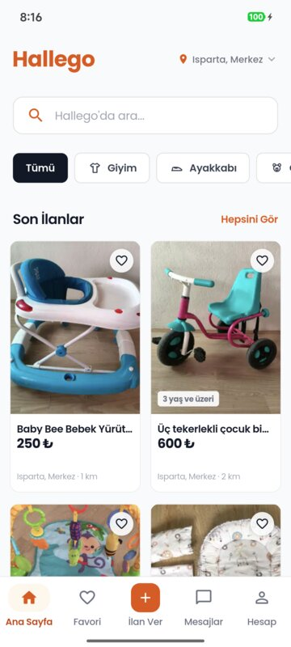
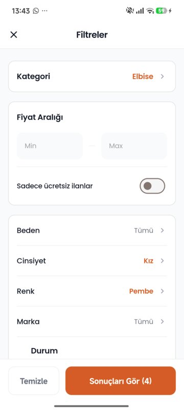
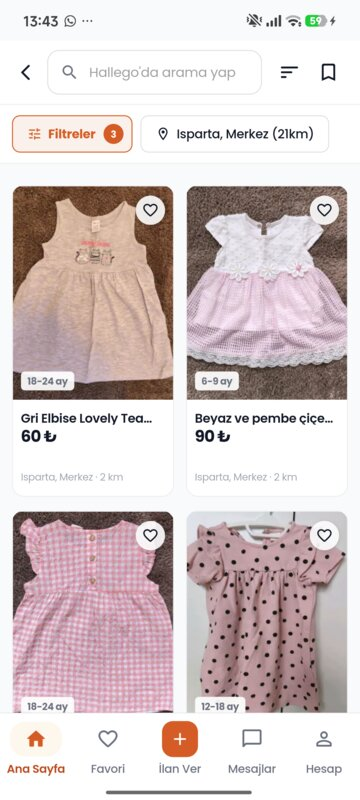
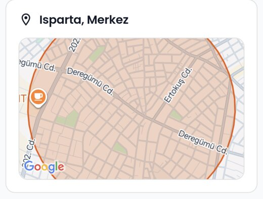

# Hallego, vitrine d'architecture

Hallego est une marketplace de seconde main hyperlocale pour les familles avec enfants, disponible sur Google Play en Turquie. J'ai conçu et réalisé seul tout le produit : API, application mobile, site web, panneau d'administration, infrastructure et modération par IA.

Le code source est privé car c'est un produit en production. Ce dépôt montre comment il est construit, avec les chiffres et une sélection de décisions d'architecture (ADR).

English version: [README.md](./README.md)

## Liens

- Application : [Hallego sur Google Play](https://play.google.com/store/apps/details?id=com.hallego.app)
- Site web : [hallego.com](https://hallego.com)
- Package open source extrait du projet : [@mdsiha369/adonis-mercure](https://www.npmjs.com/package/@mdsiha369/adonis-mercure) ([code source](https://github.com/mdsiha/adonis-mercure))

## Vue d'ensemble

Voir le schéma dans [README.md](./README.md#system-overview) (en anglais, les noms sont les mêmes).

## En chiffres

Mesurés sur le code le 2 novembre 2026.

| Élément | Chiffre |
|---|---|
| API | 30 modules, 199 endpoints, 125 migrations de base de données |
| Application mobile | 60 écrans, 45 BLoC (Flutter) |
| Tests automatisés | 1 428 API, 1 186 Flutter, 34 site web, tous réussis |
| Décisions d'architecture | 27 ADR, 5 publiés ici |

## Technologies

- **API** : Node.js 22, AdonisJS 6, TypeScript, PostgreSQL 17 avec PostGIS, Redis, BullMQ
- **Mobile** : Flutter, BLoC
- **Web** : Next.js 16, React 19, Tailwind CSS, dans un monorepo pnpm (site public et panneau d'administration)
- **Temps réel** : Mercure en Server-Sent Events
- **IA** : Anthropic Claude derrière une couche d'abstraction (OpenAI et Gemini supportés)
- **Infrastructure** : Docker, Coolify sur Hetzner, GitHub Actions, Cloudflare

## L'application

  

L'interface est en turc.

## Points à regarder

**Modération assistée par IA.** Chaque nouvelle annonce passe par un pipeline asynchrone. Un modèle de vision analyse les photos et produit un score de confiance, qui oriente l'annonce vers la publication ou vers un modérateur humain. Le pipeline a un arrêt automatique en cas de panne du modèle, des prompts versionnés, un corpus de référence pour comparer les versions et une console d'administration qui suit les coûts, la latence et la qualité.

**Messagerie temps réel.** Le chat utilise Mercure (SSE) plutôt que des WebSockets, avec des sujets privés protégés par jeton. Voir l'[ADR-0002](./docs/adr/0002-mercure-sse-over-websockets.md).

**Structure backend propre.** Chaque module suit une organisation Action, Controller, Repository pour garder des contrôleurs minces. Voir l'[ADR-0005](./docs/adr/0005-action-controller-repository.md).

**Choix d'infrastructure pragmatiques.** Recherche plein texte PostgreSQL plutôt qu'Elasticsearch ([ADR-0003](./docs/adr/0003-postgresql-fts-over-elasticsearch.md)), Redis et BullMQ plutôt qu'une file de messages cloud ([ADR-0004](./docs/adr/0004-bullmq-redis-over-cloud-queues.md)).

**Protection des données dès la conception.** Le produit respecte la loi turque sur les données personnelles (KVKK) : chiffrement au repos, journaux d'audit, suppression logique et brouillage de la position exacte côté serveur.

 L'adresse exacte n'est jamais affichée : l'application montre un cercle de 750 m calculé côté serveur.

## Contact

Michael DAS, développeur full-stack, en cours d'installation à Ottawa (Canada).
Courriel : mchdas@proton.me

&copy; 2026 Michael DAS. Tous droits réservés. Les textes et images de ce dépôt sont partagés à titre de présentation seulement.
