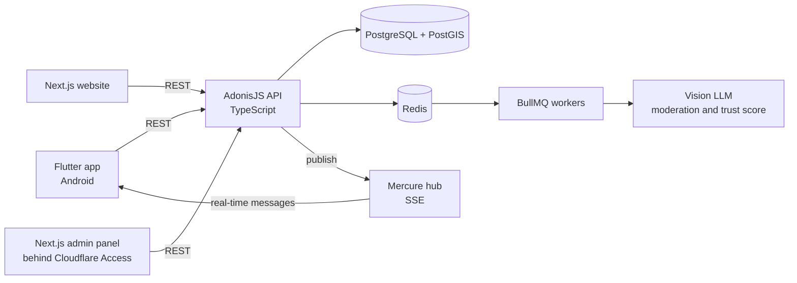
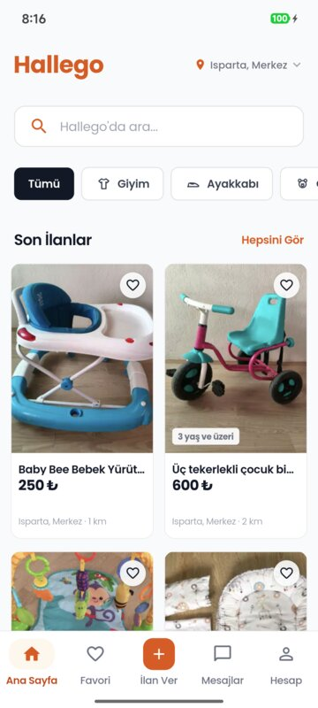
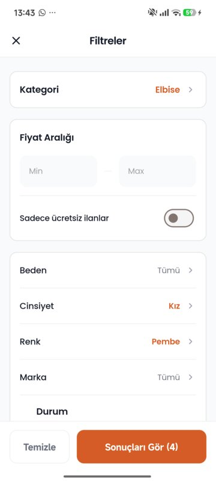
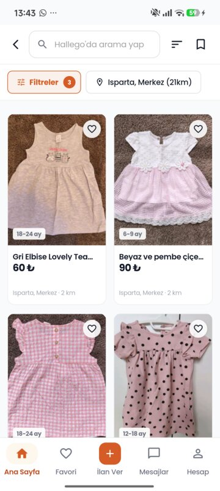
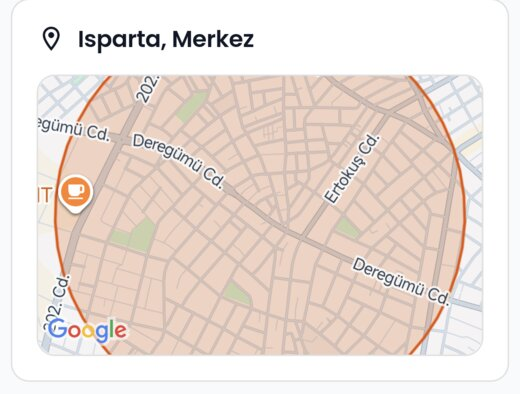

# Hallego, architecture showcase

Hallego is a hyperlocal second-hand marketplace for families with children, live on Google Play in Turkey. I designed and built the whole product on my own: API, mobile app, website, admin panel, infrastructure and AI moderation.

The source code is private because it is a product in production. This repository shows how it is built, with the numbers and a selection of the architecture decision records (ADRs).

Version française : [README.fr.md](./README.fr.md)

## Links

- App: [Hallego on Google Play](https://play.google.com/store/apps/details?id=com.hallego.app)
- Website: [hallego.com](https://hallego.com)
- Open source package I extracted from the project: [@mdsiha369/adonis-mercure](https://www.npmjs.com/package/@mdsiha369/adonis-mercure) ([source](https://github.com/mdsiha/adonis-mercure))

## System overview

## By the numbers

Measured on the code base on 2026-11-02.

| Part | Figure |
|---|---|
| API | 30 modules, 199 endpoints, 125 database migrations |
| Mobile app | 60 screens, 45 BLoCs (Flutter) |
| Automated tests | 1,428 API, 1,186 Flutter, 34 website, all passing |
| Architecture decisions | 27 ADRs, 5 published here |

## Stack

- **API**: Node.js 22, AdonisJS 6, TypeScript, PostgreSQL 17 with PostGIS, Redis, BullMQ
- **Mobile**: Flutter, BLoC
- **Web**: Next.js 16, React 19, Tailwind CSS, in a pnpm monorepo (public site and admin panel)
- **Real time**: Mercure over Server-Sent Events
- **AI**: Anthropic Claude behind a provider abstraction (OpenAI and Gemini are supported)
- **Infrastructure**: Docker, Coolify on Hetzner, GitHub Actions, Cloudflare

## The app

  

The interface is in Turkish.

## Things worth a look

**AI-assisted moderation.** Every new ad goes through an asynchronous pipeline. A vision model analyses the photos and produces a trust score, and the result routes the ad to publication or to a human moderator. The pipeline has an automatic kill switch when the model fails, versioned prompts, a benchmark corpus to compare prompt versions, and an admin console that tracks cost, latency and quality.

**Real-time messaging.** Chat uses Mercure (SSE) rather than WebSockets, with token-scoped private topics. See [ADR-0002](./docs/adr/0002-mercure-sse-over-websockets.md). The adapter I wrote for AdonisJS is published on npm.

**Clean backend structure.** Each business module follows an Action, Controller, Repository layout so that controllers stay thin. See [ADR-0005](./docs/adr/0005-action-controller-repository.md).

**Pragmatic infrastructure choices.** PostgreSQL full-text search instead of Elasticsearch ([ADR-0003](./docs/adr/0003-postgresql-fts-over-elasticsearch.md)), and Redis with BullMQ instead of a cloud queue ([ADR-0004](./docs/adr/0004-bullmq-redis-over-cloud-queues.md)).

**Privacy by design.** The product follows the Turkish data protection law (KVKK): encryption at rest, audit logs, soft deletes, and server-side obfuscation of exact locations.

 The exact address is never shown: the app displays a 750 m circle computed on the server.

## Published decision records

| ADR | Decision |
|---|---|
| [0001](./docs/adr/0001-adonisjs-v6-over-nestjs.md) | AdonisJS 6 over NestJS |
| [0002](./docs/adr/0002-mercure-sse-over-websockets.md) | Mercure and SSE over WebSockets |
| [0003](./docs/adr/0003-postgresql-fts-over-elasticsearch.md) | PostgreSQL full-text search over Elasticsearch |
| [0004](./docs/adr/0004-bullmq-redis-over-cloud-queues.md) | BullMQ and Redis over cloud queues |
| [0005](./docs/adr/0005-action-controller-repository.md) | Action, Controller, Repository pattern |

The other ADRs cover security and operations details and stay private.

## Contact

Michael DAS, full-stack software engineer, relocating to Ottawa, Canada.
Email: mchdas@proton.me

&copy; 2026 Michael DAS. All rights reserved. The text and images in this repository are shared for presentation purposes only.
