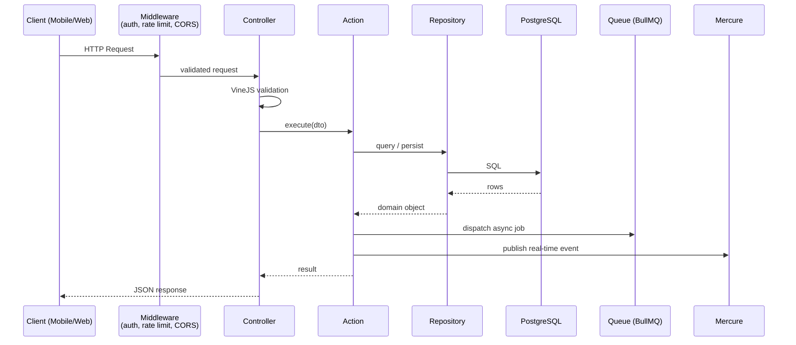

# ADR-0005: Action / Controller / Repository pattern

- **Status**: Accepted
- **Date**: 2024 (decision), recorded 2026-05-08
- **Deciders**: Michael DAŞ

## Context

The backend had 28 business modules when this was written (30 today) and keeps growing. Without a strict
internal structure, controllers tend to accumulate business logic,
data access, validation, and side effects in a single file. This
makes them:

- Hard to test (HTTP context required for unit tests)
- Hard to reuse (logic locked behind a route)
- Hard to read (mixed levels of abstraction in one method)

We needed a pattern that:

1. Enforces separation between HTTP concerns, business logic, and
   data access
2. Is consistent across all modules so that a developer landing
   in any module knows where to look
3. Plays well with AdonisJS's IoC container and `@inject()`
   decorator
4. Stays close to the framework's idioms, no external DI libraries
   or unusual indirection

## Decision

Every business module follows the **Action / Controller / Repository**
structure:

```
app/{module}/
├── controllers/   ← validates HTTP input via VineJS, calls Action,
│                    formats response
├── actions/       ← injectable class with one public method
│                    (`execute`) containing pure business logic
├── repositories/  ← all Lucid ORM queries for the module
├── models/        ← Lucid models (Active Record)
├── jobs/          ← BullMQ async tasks
├── enums/         ← typed constants
└── mails/         ← email templates
```

**Rules:**

- Controllers do not query the database directly. They receive
  validated input, call an Action, return a response.
- Actions do not know about HTTP. They take primitive arguments
  (IDs, DTOs) and return domain values.
- Actions delegate all data access to Repositories.
- Repositories return models or DTOs, never raw query builder
  results.
- Cross-module calls go through Actions, not Controllers, and
  never through Repositories.

Dependency injection is performed natively via AdonisJS `@inject()`
on Action and Controller constructors.

The flow of a typical request through the layers:



## Alternatives Considered

### Option A: Fat controllers

Put everything in the controller. Standard for small AdonisJS apps.

**Rejected because:**

- Becomes unmaintainable past 5-10 modules.
- Logic locked to HTTP, cannot be reused from a CLI command, a
  job, or another module.
- Testing requires HTTP context plumbing.

### Option B: Service layer (no Repository, no Action)

Single `*Service` class per module containing all business logic
and ORM calls.

**Rejected because:**

- Services tend to grow to 500+ lines as features accumulate.
- Mixing query construction and business logic in the same class
  defeats the readability gain. A service ends up looking like a
  fat controller without the HTTP boilerplate.
- Hard to reason about query performance when DB calls are
  scattered across business methods.

### Option C: Hexagonal / Clean Architecture with ports and adapters

Full-blown DDD with domain entities, value objects, application
services, and infrastructure adapters.

**Rejected because:**

- Massive overkill for a CRUD-heavy classifieds app where most
  business logic is "validate, save, dispatch event".
- Onboarding cost for any future contributor is high.
- Fights the AdonisJS conventions (Lucid is Active Record by
  design, not Repository).

### Option D: One file per HTTP route (single-action controllers)

Each route is its own controller class with a single `handle()`
method.

**Adopted partially:** controllers in Hallego *are* single-action.
What we added is the explicit Action layer beneath, so controllers
can stay thin and Actions can be reused from jobs and CLI commands.

## Consequences

### Positive

- **Consistent navigation**: a developer looking for "where is the
  logic that approves an ad" always finds it in
  `app/admin/ads/actions/`. No archaeology.
- **Testable business logic**: Actions are plain classes with
  injected dependencies. Unit tests do not need HTTP context.
- **Reusable Actions**: the same `ApproveAdAction` is called from
  the admin controller, an admin CLI command, and an automated
  moderation job, all without duplication.
- **Predictable file size**: controllers stay around 30-50 lines,
  Actions around 50-150 lines. Files do not balloon.
- **Repository keeps query knowledge in one place**: optimizing a
  query (adding an index, eager-loading a relation) requires
  reading one file.

### Negative

- **More files per feature**: a CRUD endpoint that would be one
  fat controller becomes 3-4 files. Verbose for trivial cases.
- **Indirection cost**: tracing a request from HTTP to DB requires
  jumping through Controller → Action → Repository. Slower
  initial reading for newcomers.
- **Boilerplate**: each new endpoint requires creating multiple
  files. Mitigated by Ace generators but still noticeable.
- **Some modules are over-structured**: read-only endpoints with
  no business logic (e.g. `GetAdAction` is 9 lines) might not
  justify a separate Action. We accept the consistency cost.

### Neutral

- The pattern resembles but is not identical to Laravel's
  "single-action controllers + Actions" idiom popularized by
  Spatie. The naming and structure are familiar to PHP developers
  joining the team.

## References

Paths below refer to the private repository.

- `backend/app/ad/`, minimal example
- `backend/app/ad_submission/`, full example
  with jobs, listeners, and complex orchestration
- `backend/app/admin/ads/`, admin module example
- ARCHITECTURE.md § Backend Architecture Pattern
